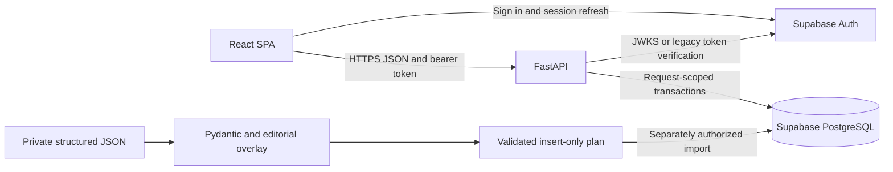

# Architecture

This page describes the current implementation. Dated verification belongs in
[reports](../README.md#verification-reports); superseded plans are in
[archive](../archive/README.md).

## Frontend

React Router provides lazy-loaded routes; TanStack Query manages API state and
account-scoped caches. Thai/Japanese fonts, semantic ruby and structured lesson
sections share the same responsive design. Guest progress is validated in
localStorage. Changing accounts clears private caches and remounts learning
routes; signing in does not automatically synchronize guest records. Sync
requires a preview and explicit choices.

## API and persistence

FastAPI serves `/api/v1` and OpenAPI. Explicit sample mode supports the public
sample; database mode fails closed rather than falling back to sample account
writes. Liveness reports configuration, not proof of database connectivity.

SQLAlchemy uses lazy, bounded connection pooling, request-scoped sessions,
encrypted transport and disabled prepared statements for transaction pooling.
Public reads are READ ONLY. Account mutations use per-owner advisory locks and
expected row versions; successful transactions commit before returning success.
Quiz submission UUIDs make identical retries idempotent. No schema/import
operation runs at startup.

The 16-table schema separates Kanji, components, readings, relationships,
vocabulary, lesson placements, section blocks, question keys and owner progress.
See the [schema review](SCHEMA_REVIEW.md), [ERD](ERD.md) and
[database guide](../guides/DATABASE.md). SQLite supports tests/local account
development, not durable hosted storage.

## Authorization and content visibility

The browser uses public Auth configuration; database credentials stay
server-side. The API verifies the token signature, project issuer, audience,
time claims, role and UUID subject. Every account query derives its owner from
that verified subject. Privileged database connections can bypass RLS, so
application owner/publication predicates remain mandatory. See
[security boundaries](SECURITY.md).

Published free content and explicitly enabled samples are distinct from private
staging. Catalog visibility is separately controlled. Local development access
requires an explicit authenticated UUID allowlist; hosted Preview/Production
reject that bypass. Existing book lessons remain private/needs_review and zero
chapters have full editorial approval.

## Educational content pipeline

An immutable private JSON edition passes strict Pydantic validation, source
reconciliation and an edition-bound editorial overlay. Occurrences retain file
digests, JSON pointers and PDF pages. Shared records are deduplicated without
losing lesson relationships or contextual glosses. Missing source data is
flagged instead of fabricated; mnemonic relations are not certified etymology.
Comparison explanations are pending manual review.

The importer receives a caller-owned session, inserts missing natural keys and
reports editorial differences without overwriting them. The remote caller adds
hash/schema checks, transaction/advisory/table locks and pre/postcommit
verification. Public builds require no PDF or private JSON. See the
[pipeline guide](../guides/CONTENT_PIPELINE.md).

## Deployment boundary

Vercel preparation uses separate frontend and FastAPI roots. Static production
builds use an exact backend HTTPS origin and public Supabase configuration; the
backend uses exact CORS origins and private/no-store responses. Upload
allowlists exclude private material, credentials, test artifacts and
import/migration tooling. No hosted deployment is claimed; follow the
[deployment runbook](../guides/DEPLOYMENT.md) after approval.
