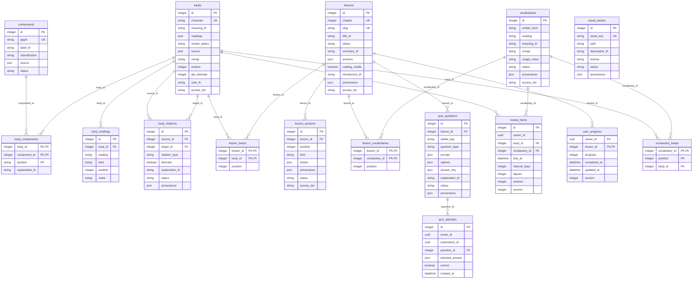

# Learning database ERD

Generated from SQLAlchemy metadata with the
[schema generator](../../scripts/write_erd.py). Migration alignment is tested
with Alembic against isolated PostgreSQL.

The unchanged generator writes the legacy docs/ERD.md compatibility path. Review
and reconcile its output with this canonical diagram; see
[generator maintenance](../guides/PUBLICATION.md#documentation-generators).

Supabase-only migration constraints additionally reference auth.users(id) for
user_progress, review_items and quiz_attempts. That external schema is not owned
by this application's ORM metadata.
