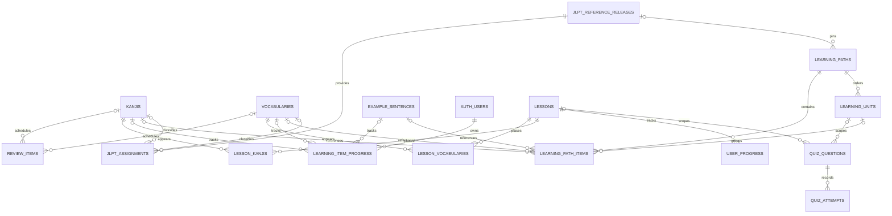
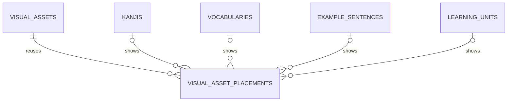

# สถาปัตยกรรมการเรียนตามหมวดและ JLPT N5–N1 สำหรับ Kanji Connection

## 1. ข้อสรุปและขอบเขตหลักฐาน

เสนอให้เพิ่มเส้นทาง «เรียนตามหมวด» และ «เตรียม JLPT» ข้างเส้นทางหนังสือ 30 บท ใช้ `kanjis` และ `vocabularies` เป็นระเบียนหลักร่วมกัน เพิ่มระเบียนประโยคและตารางเชื่อมสำหรับจัดเนื้อหา และเก็บระดับ JLPT พร้อมรุ่นแหล่งอ้างอิง เส้นทางใหม่ใช้ renderer และกลไกฝึกเดิมผ่านตัวแปลงข้อมูล พร้อมแยกความคืบหน้ารายรายการออกจากสถานะอ่านจบรายบท

**ยืนยันแล้ว** จาก source tree ที่ `4547e8b6af1cd7421bd58386ca5f374a9d38244d`, ORM, Alembic ทั้งสอง revision, PostgreSQL ที่ `backend/.env` ชี้ไปผ่าน `SET TRANSACTION READ ONLY`, หลักฐานการเผยแพร่ฉบับ `2026-11-19-final-v2`, SQLite snapshot ก่อนเผยแพร่แบบอ่านอย่างเดียว และ frontend audio index ใน Git การเทียบ JLPT อ่าน CSV จาก commit ที่ระบุในหน่วยความจำ ตัวเลขด้านล่างสะท้อนฐานข้อมูลที่ตรวจ ณ 25 พ.ย. 2026 ตามวันที่ใน workspace

**ขอบเขตการยืนยัน** ตรวจนับระเบียนเนื้อหาที่เผยแพร่และตรวจการกรองจาก source code ไม่ตรวจข้อมูลส่วนบุคคลหรือทดสอบการเขียนบัญชี ค่าการเปิดเขียนบัญชีใน publication receipt เป็นหลักฐาน ณ วันเผยแพร่ การตรวจนี้ไม่ได้ยืนยันค่าปัจจุบันของ Vercel หรือการฟังเสียงทุกรายการ เอกสารสถาปัตยกรรมเดิมบางส่วนยังอ้างพฤติกรรมของ preview จึงใช้ source และผลตรวจฐานข้อมูลเป็นหลักเมื่อหลักฐานต่างกัน [คู่มือเอกสาร](../README.md) · [รายงานการเปิดเนื้อหาสาธารณะ](../reports/PUBLIC_LEARNING_REDESIGN.md)

## 2. ระบบปัจจุบันที่ตรวจสอบแล้ว

### 2.1 ฐานข้อมูลและการเข้าถึง

มี **16 ตารางของแอปใน `public` และ 1 ตาราง `public.alembic_version` รวม 17 ตารางใน `public`** จาก `pg_class` และ `information_schema.columns` โดย migration ปัจจุบันคือ `0002` Revision `0001` สร้าง 4 ตารางแรก และ `0002` เพิ่มอีก 12 ตารางพร้อม constraints, RLS, policies และการถอน grants ฐานข้อมูลยังมี schemas ของ Supabase เช่น `auth`, `storage`, `realtime`, `vault`, `extensions`, `graphql` และ `graphql_public` จำนวน 17 นับเฉพาะ `public` ผลตรวจไม่พบ application views ใน `public` หรือ schema `api`/`kanji_api` การเผยแพร่เนื้อหาอาศัย query และการคัดฟิลด์ใน FastAPI [ORM](../../backend/app/models.py) · [0001](../../backend/migrations/versions/0001_content_foundation.py) · [0002](../../backend/migrations/versions/0002_learning_domain_and_database_api.py) · [ERD ปัจจุบัน](../architecture/ERD.md)

| ตาราง | โครงสร้างที่ใช้จริง | คลังที่ตรวจ |
| --- | --- | ---: |
| `kanjis` | PK `id`, `character` unique และยาว 1 ตัวอักษร, ความหมายไทย, romaji, strokes, `readings` JSON เดิม, `note_th`, source และสถานะ | 358 published/free |
| `kanji_readings` | FK `kanji_id`, unique `(kanji_id, reading, kind)`, `on`/`kun`/`other`, ตำแหน่งและ notes | 481 (179 on, 302 kun) |
| `components` | PK `id`, unique `glyph`, label, classification, source และสถานะ ส่วนประกอบมี identity ของตนเอง | 3 |
| `kanji_components` | M:N ผ่าน PK `(kanji_id, component_id, position)`, มีคำอธิบายบริบท | 0 |
| `kanji_relations` | FK `source_id`, `target_id` ไป `kanjis`; unique ตามคู่และชนิด, ห้ามอ้างตัวเอง, มีทิศทางและ provenance | 240 |
| `vocabularies` | PK `id`, unique `(written_form, reading)`, ความหมายไทย, romaji, usage notes และ provenance | 197 published/free |
| `vocabulary_kanjis` | PK `(vocabulary_id, position)`, FK `kanji_id`; เก็บตัวซ้ำตามตำแหน่งในคำได้ | 313 |
| `lessons` | PK `id`, `chapter` และ `slug` unique, `chapter BETWEEN 1 AND 30`; `anchors`, คำเกริ่น, `catalog_visible`, สถานะกับ access tier | 30 published/free/catalog-visible |
| `lesson_kanjis` | PK `(lesson_id, kanji_id)` และตำแหน่ง | 420 placements, 313 คันจิไม่ซ้ำ |
| `lesson_vocabularies` | PK `(lesson_id, vocabulary_id)` และตำแหน่ง | 240 placements |
| `lesson_sections` | FK `lesson_id`, unique `(lesson_id, position)`, `kind`, `blocks` JSON, provenance และสถานะ | 210 published/free |
| `visual_assets` | PK `id`, unique `asset_key`, `path`, คำอธิบาย, license, status และ provenance; ปัจจุบันไม่มี FK เชื่อมกับบทหรือคันจิ | 0 |
| `quiz_questions` | FK `lesson_id`, unique `(lesson_id, stable_key)`, prompt/options/answer key แบบ JSON พร้อมคำอธิบายและสถานะ | 450 published |
| `quiz_attempts` | FK `question_id`, owner UUID, unique `(owner_id, submission_id)`, ผลตรวจที่ใช้ตอบซ้ำ | ไม่ตรวจนับ |
| `review_items` | owner UUID, FK ได้หนึ่งใน `kanji_id`/`vocabulary_id`, unique ต่อ owner/เป้าหมาย, index `(owner_id, due_at)`, schedule/version | ไม่ตรวจนับ |
| `user_progress` | PK `(owner_id, lesson_id)`, `progress` 0–100, `completed_at`, `updated_at`, `version` | ไม่ตรวจนับ |

ทั้ง 17 ตารางใน `public` เปิด RLS ผลตรวจพบ `owner_scope` บน 3 ตารางของบัญชี Migration เพิ่ม FK ไป `auth.users(id) ON DELETE CASCADE` ใน Supabase ที่มี `auth.uid()` และ role `authenticated` และถอนสิทธิ์จาก `PUBLIC`, `anon`, `authenticated` รวมถึงบน ledger แอปอ่านผ่าน `read_session` ซึ่งตั้ง transaction read-only และตรวจ `published`/`free` ตามชนิดข้อมูลกับ `catalog_visible` สำหรับ catalog ส่วน `/me/*` ตรวจ Supabase bearer token ใช้ `sub` เป็น owner ตั้ง JWT claim ใน transaction และ serialize คำขอต่อ owner ด้วย advisory lock การเขียนขึ้นกับ `ENABLE_USER_WRITES` Hosted Vercel ใช้ `database` mode และปิด sample/allowlist สำหรับเนื้อหา private ขณะที่ sample mode มี demo อิสระใน code [Database session](../../backend/app/database.py) · [Auth](../../backend/app/auth.py) · [การตั้งค่า](../../backend/app/config.py) · [Learning routes](../../backend/app/learning_routes.py)

### 2.2 การจัดบท 30 บท

เลขบทกับ slug `chapter-01`–`chapter-30` เป็น identity ของหนังสือ Catalog API แบ่ง `part` 1–6 ทุกห้าบทด้วย `(chapter - 1) // 5 + 1` ส่วน UI `chapterGroup()` ใช้กลุ่มการเรียนตามช่วงด้านล่าง ทั้งสองมุมมองอ้างเลขบทชุดเดียวกัน

| บท / กลุ่ม UI | หัวข้อตามลำดับในฐานข้อมูล |
| --- | --- |
| 01–05 / `basic` | คน รูปร่าง และขีดที่เปลี่ยนความหมาย · ต้นไม้และการเติบโต · ดวงอาทิตย์ ดวงจันทร์ และดวงตา · ธรรมชาติรอบตัว · ตัวเลขและสัญลักษณ์ง่าย ๆ |
| 06–10 / `basic` | คนและครอบครัว · มือ เท้า และการกระทำ · ปาก คำพูด และภาษา · บ้าน หลังคา และอาคาร · ประตู ทางเข้า และทางออก |
| 11–15 / `similar` | ต่างกันเพียงขีดเดียว · ต่างกันเพียงจุดเดียว · เส้นสั้น เส้นยาว และทิศทาง · รูปร่างคล้าย แต่ความหมายต่าง · ตัวที่สับสนบ่อยในคำศัพท์ |
| 16–20 / `component` | กลุ่มน้ำ 氵 · กลุ่มคน 亻 · กลุ่มมือ 扌 · กลุ่มหัวใจ 忄 · กลุ่มพืช 艹 และไม้ 木 |
| 21–25 / `component` | กลุ่ม 青 และเสียงที่เกี่ยวข้อง · กลุ่ม 寺 และเสียงที่เกี่ยวข้อง · กลุ่ม 交 และ 包 · คันจิหลายส่วนประกอบ · กลุ่มคล้ายกันระดับสูง |
| 26–29 / `everyday` | คันจิบนป้ายและสถานี · คันจิในร้านอาหาร · คันจิเรื่องเวลาและวันที่ · คันจิในประโยคทั่วไป |
| 30 / `review` | ทบทวนรวมและทดสอบความจำ |

ฉบับเผยแพร่จัด 14 ตำแหน่งคันจิและ 7 sections ต่อบท ได้แก่ `introduction`, `cards` สองชุด, `comparison`, `mnemonic`, `vocabulary`, `exercises` คันจิ 45 ตัวเป็น `source.kind = supporting_printed_glyph` และอยู่ในคลังคันจิเผยแพร่ แต่ไม่มีตำแหน่งใน `lesson_kanjis` คำและคำอ่านที่ผู้เรียนเห็นในบทอาจมีบริบทต่างจาก dictionary record เพราะบทอ่านการ์ดและคำศัพท์ที่บรรณาธิการวางใน `blocks` ประโยคยังอยู่ใน `vocabulary` blocks โดย snapshot ของ edition นี้มี 5 ตำแหน่งที่บท 27 และ 29 ไม่มีตารางประโยค `jlpt_estimate` ของคันจิทั้ง 358 ตัวเป็น `NULL` [ตัวจัดกลุ่ม UI](../../frontend/src/presentation-types.ts) · [DatabaseRepository](../../backend/app/repository.py) · [publication script](../../scripts/publish_working_edition.py) · `private/publication-release/receipt.json` (หลักฐานในเครื่อง)

### 2.3 การเรียน การเปรียบเทียบ และการติดตาม

| ส่วน | พฤติกรรมที่ยืนยันจาก code |
| --- | --- |
| Guided Learning | `pages/Lesson.tsx` โหลด `/learning/lesson/{slug}` และ catalog จากนั้น `LessonExperience` กับ `deriveStages()` จัดจาก `LessonDetail.sections` และการ์ดเป็น discover → learn → use/connect เมื่อมีเนื้อหา → quick check เมื่อมีคันจิ → review การ์ดจัดเป็นช่วงประมาณ 3–4 ใบตามขนาดชุดเดิม Quick Check ข้ามได้และไม่บันทึกคะแนน โหลด `/learning/practice/{slug}?include_feedback=true` เลือกสูงสุด 2 ข้อที่ไม่ใช่โจทย์รูป แล้วใช้ `PracticeRound` ในโหมด checkpoint |
| Full Lesson | ใช้ payload เดียวกันและ render ด้วย `lesson-sections.tsx` ตามลำดับต้นฉบับ มีการ์ด คู่เปรียบเทียบ แผนภาพช่วยจำ คำศัพท์และประโยค `learner_block()` คัดเฉพาะ public fields และข้าม raw `source_page_text` normalized readings ใช้ใน serializer ของคันจิ ส่วนการ์ดบทอ่าน `study.reading`, `study.example` และ `mnemonic_note_th` จากบริบทของบท |
| Kanji Explorer และรายละเอียด | `Explorer.tsx` ใช้ `/learning/kanjis` แบบแบ่งหน้า `KanjiDetail.tsx` ใช้ `/kanjis/{character}`, `/relations`, `/vocabulary` ใต้ resource เดียวกัน Public Explorer ใช้ `DatabaseRepository.kanjis` และรวม glyph ที่ผ่าน published/free; allowlisted dev branch ของ `/learning/kanjis` และ `/me/review-cards` กรอง supporting glyph ออก |
| การเปรียบเทียบ | `/compare` และ `/learning/compare` เปรียบเทียบคันจิ 2–4 ตัวตามลำดับที่เลือก `kanji_relations` เก็บความคล้ายรูป/ส่วนประกอบ/เสียง/ภาพจำ/ที่มาทางประวัติศาสตร์ ส่วน `/learning/comparison-groups` ประกอบ 94 กลุ่มของ edition จาก `pairs`, cards, tips และ rubric ใน blocks รวมกลุ่มพิเศษจากเงื่อนไขเลขบท 1/12/17 และรองรับปลายทางที่เป็น component |
| Quiz | ตารางเก็บ 210 `kanji_meaning`, 210 `vocabulary_reading` และ 30 `comparison` ระบบเดิม `/learning/questions/{slug}` และ `/learning/check/{question_key}` มีคำตอบอิสระและ manual rubric ส่วนหน้า `Quiz.tsx` ใช้ MCQ ที่ `learning_presentation.py` ประกอบจาก source questions (ความหมาย 210 คำอ่าน 210 และโจทย์รูป 30 ตาม edition) โดยเก็บ FK กลับไป source question เมื่อบันทึกบัญชี `/learning/practice/{slug}` ค่าเริ่มต้นส่งเฉพาะโจทย์/ตัวเลือก แต่ `?include_feedback=true` ที่หน้า Quiz ใช้ส่งเฉลยล่วงหน้าโดยตั้ง `private, no-store` จึงเหมาะกับการฝึกพร้อม feedback |
| Flashcards/review | `/review` เป็น account gate; due queue ใช้รายการที่ยังไม่เคยทวนหรือถึงกำหนด API ที่ใช้อยู่รองรับการให้คะแนนเฉพาะคันจิ แม้ schema รองรับ vocabulary แล้ว จำได้เพิ่ม interval เป็นสองเท่าจากอย่างน้อย 1 วัน สูงสุด 90 วัน จำไม่ได้กลับ 1 วันและเพิ่ม lapses; ใช้ `expected_version` กันข้อมูลทับกัน พร้อมเปิดเสียงหลัง reveal |
| Progress และ retry | Guided/Full จำตำแหน่งอ่านใน browser ต่อ slug (`kanji:lesson-position:v1:…`) สถานะบัญชีใช้ปุ่มบันทึกอ่านจบใน `lesson-save-progress.tsx` ส่ง 100 ไป `/me/progress/{slug}` ทุก attempt ผูก UUID สำหรับ retry และเก็บผลเดิม; `practice-saves.ts` มีคิว retry สำหรับบัญชี Dashboard อ่าน progress, ประวัติฝึก และ due เดิม ผู้เรียนทั่วไปอ่านและตรวจแบบฝึกได้ ส่วน legacy guest sync ใช้ preview/apply ที่ผู้ใช้เลือกเอง |

หลักฐาน [หน้า Lesson](../../frontend/src/pages/Lesson.tsx) · [LessonExperience](../../frontend/src/lesson-experience.tsx) · [deriveStages](../../frontend/src/lesson-stages.ts) · [renderers](../../frontend/src/lesson-sections.tsx) · [ตัวคัดข้อมูล](../../backend/app/content_views.py) · [ตัวประกอบ MCQ/กลุ่มเปรียบเทียบ](../../backend/app/learning_presentation.py) · [Learning service](../../backend/app/learning.py) · [Quiz](../../frontend/src/pages/Quiz.tsx) · [Review](../../frontend/src/pages/Review.tsx) · [Auth and progress](../guides/AUTH_AND_PROGRESS.md)

### 2.4 ข้อจำกัดที่ต้องเผื่อก่อนขยาย

| ข้อจำกัด | ผลต่อการออกแบบ |
| --- | --- |
| `chapter_range`, `part` 1–6, `chapterGroup()` และชื่อ/ลิงก์ที่อิงเลขบท | ให้จำกัดกับหนังสือต่อไป เส้นทางใหม่ใช้ slug และ unit key ของตนเอง |
| `content_schema.py`, `content_revision.py`, `json_content.py`, `editorial_sync.py`, `seed.py`, `book.schema.json` และสคริปต์ import/publish ฝังเงื่อนไขฉบับ 30 บท | รักษา validation/receipt เดิมสำหรับหนังสือ สร้าง schema/manifest สำหรับเนื้อหาขยายแยกจาก pipeline ของ PDF |
| Catalog presentation ค่า public default limit 30, `/search` คืนสูงสุด 30, Explorer ทีละ 30 และ review API ตัดที่ 500 หลังโหลดคันจิ | 30 ใน Explorer คือขนาดหน้า ส่วน review cap ทำให้ข้อมูลเกินหน้าเข้าคิวไม่ได้โดย API เดิม ออกแบบ pagination ฝั่ง SQL และ batch serialization สำหรับเส้นทางใหม่ |
| `GuestSnapshot.lessons` สูงสุด 30 รายการ, `user_progress` อ้าง `lesson_id`, question key/links ใน dashboard อิง slug ของบท | รักษาสัญญาเดิม ใช้ identity และ payload ของเส้นทางใหม่ และแยก mapper ของประวัติฝึกตามประเภท |
| ชื่อ `category` ใน JSON การ์ดและกลุ่มเปรียบเทียบ, กลุ่มตามช่วงบทใน Catalog, `components.classification` | แต่ละค่าให้ความหมายเฉพาะบริบทและไม่มี FK ไปหมวดร่วม ใช้หมวดใหม่ผ่าน membership ที่กำหนดชัดเจน |
| Audio manifest ผูก edition/PDF/receipt เดิม; frontend โหลด index รวมและ Quiz มี lookup ตาม slug | คง lookup เดิม ใช้ payload ตามหน่วยหรือ shard สำหรับ expansion เมื่อข้อมูลเพิ่ม |

หลักฐาน [schema หนังสือ](../../backend/app/content_schema.py) · [revision](../../backend/app/content_revision.py) · [sync](../../backend/app/editorial_sync.py) · [limits ของ API](../../backend/app/main.py) · [progress schema](../../backend/app/learning_schema.py) · [Explorer](../../frontend/src/pages/Explorer.tsx) · [คู่มือ pipeline](../guides/CONTENT_PIPELINE.md)

### 2.5 VOICEVOX และ Supabase Storage

ระบบปัจจุบันใช้ 四国めたん (Shikoku Metan) — ノーマル, style ID `2` เอกสารและบันทึกของชุดเผยแพร่ระบุ Engine `0.26.2` เส้นทาง `build_japanese_audio_manifest.py` → `prepare_japanese_audio_release.py` → `generate_voicevox_audio.py`/packaging → `publish_japanese_audio.py` ตรวจคำอ่านและบริบท สร้างเสียงสำหรับข้อความสังเคราะห์ที่ผ่านการคัด ตรวจ WAV/MP3 และ SHA-256 โดย `audio_id` เดิมมาจาก speaker UUID, style และข้อความสังเคราะห์ รายการเดียวสามารถชี้ไปคลิปเดียวกันได้หลายตำแหน่ง

`frontend/public/assets/japanese-audio-index.json` เป็น index v2 มี 604 file mappings, 1,181 shared keys และ 1,861 keys รวมใน 30 lesson scopes ตัวกุญแจ lookup ใช้ชนิด (`kanji`, `component`, `word`, `sentence`, `term`, `quiz_choice`), ข้อความ และคำอ่าน normalized ผ่าน SHA-256 ตัด 16 bytes; frontend หา lesson scope ก่อน shared จากนั้น resolve ไป `ja/metan-normal/<audio_id>/<mp3-sha256>.mp3` ใน bucket `kanji-japanese-audio` ผ่าน public object URL และ `VITE_SUPABASE_URL` `term` fallback ใช้เมื่อเหลือคลิปที่ชัดเจน Quiz มี mapping ตามบทเพื่อไม่ทำให้ตัวเลือกกลายเป็นเฉลยจาก index ตัว player จัดการ stop, loading, error และเล่นทีละคลิป `publish_japanese_audio.py` ตรวจ profile ของ bucket ตามคู่มือ (public, `audio/mpeg`, 1 MiB), ใช้ credentials ฝั่ง release สำหรับ upload และรองรับตรวจ public bytes แบบไม่ใช้ secret

Audit artifact ของชุดเดิมรายงาน 1,044 รายการบริบท, 4,163 source references, 604 MP3 รวม 3,468,368 bytes และ 1,026 จาก 1,027 รายการที่มีสิทธิ์นับ coverage โดยตัด 17 reference-only ออก รายการที่ยังขาดเสียงมาจากคำที่บริบทไม่ชี้คำอ่านเดียว `human_approved = 0` ใน artifact หมายถึงยังไม่มีสถานะตรวจฟังรายคลิปในรายงาน แม้ชุดไฟล์ได้รับอนุมัติให้ใช้ตามคู่มือ ตัวเลขนี้วัด coverage ของ manifest และไม่ใช่ coverage ของเสียงตามระดับ JLPT [คู่มือเสียง](../guides/JAPANESE_AUDIO.md) · [Audio player](../../frontend/src/lesson-audio.tsx) · [ดัชนี playback](../../frontend/public/assets/japanese-audio-index.json) · `private/audio-voicevox/release/audit.json` (หลักฐานในเครื่อง)

**ผลตรวจ API และ Storage เพิ่มเติม** เรียก public GET ผ่าน FastAPI ในเครื่องกับฐานข้อมูลที่ตั้งค่าไว้โดยไม่ส่ง bearer token ได้ 30 บท, 94 กลุ่มเปรียบเทียบ, 450 MCQ รวมทุก slug และ 358 คันจิเมื่อแบ่งหน้าละ 100 ดัชนี Storage ตัวอย่างหนึ่งตอบ HTTP 200, `audio/mpeg` และ SHA-256 ตรงกับ object path การตรวจนี้ยืนยันพฤติกรรมของ source tree และไฟล์สาธารณะหนึ่งรายการ

## 3. แหล่ง JLPT และผลเทียบคลังจริง

### 3.1 แหล่งข้อมูลและสิทธิ์

ผู้จัด JLPT เผยแพร่คำอธิบายความสามารถและตัวอย่างข้อสอบสำหรับ N5–N1 แต่ไม่ได้เผยแพร่ชุด `Test Content Specifications` ที่แจกแจงคำ คันจิ และไวยากรณ์สำหรับข้อสอบระบบปัจจุบัน ระดับที่แสดงในแอปจึงเป็นการจัดระดับอ้างอิงตามชุดข้อมูลที่เลือก และตัวเลข coverage วัดเทียบกับชุดนั้นเท่านั้น ข้อความแนะนำใน UI คือ «ระดับอ้างอิงสำหรับเตรียม JLPT» พร้อมแหล่งและ version [JLPT FAQ](https://jlpt.jp/sp/e/faq/index.html) · [สรุปความสามารถรายระดับ](https://www.jlpt.jp/e/about/levelsummary.html) · [ตัวอย่างข้อสอบทางการ](https://www.jlpt.jp/e/samples/forlearners.html)

| แหล่ง | ใช้เพื่ออะไรและข้อจำกัด |
| --- | --- |
| `OpenJLPT` ที่ commit `0d1d3410bec90bd4098a7c72de820543cb4f707c` | เลือกเป็น baseline ของ audit เพราะมี CSV รายระดับทั้งคันจิและคำศัพท์, ระบุ upstream และใช้ `jmdict_id` กับ `other_forms` ช่วยตรวจคำนอก exact match การจัดระดับมาจาก Jonathan Waller/Tanos ซึ่งเป็นชุดอ้างอิงชุมชน รุ่นนี้ประกอบและแก้ข้อมูลร่วมกับพจนานุกรม ผลของแหล่งอื่นอาจต่างกัน Dataset ใช้ CC BY-SA 4.0 พร้อม attribution ให้ OpenJLPT และ upstream, link license, ระบุการแก้ไข และเผยแพร่ derivative dataset ภายใต้ ShareAlike [snapshot](https://github.com/evanclan/OpenJLPT/tree/0d1d3410bec90bd4098a7c72de820543cb4f707c/data/csv) · [NOTICE](https://github.com/evanclan/OpenJLPT/blob/0d1d3410bec90bd4098a7c72de820543cb4f707c/NOTICE.md) · [LICENSE](https://github.com/evanclan/OpenJLPT/blob/0d1d3410bec90bd4098a7c72de820543cb4f707c/LICENSE) |
| `JMdict` และ `KANJIDIC2` จาก EDRDG | ใช้ตรวจ spelling/readings, identity, POS และข้อมูลคันจิ ฟิลด์ `jlpt` ของ KANJIDIC2 เป็นระบบ 1–4 ก่อนปี 2010 ให้เก็บแยกจาก N5–N1 หากต้องใช้งาน EDRDG ระบุ CC BY-SA 4.0, การให้เครดิตและลิงก์เอกสาร รวมถึงขั้นตอนอัปเดตสม่ำเสมอ โดยยกตัวอย่างบริการพจนานุกรมเว็บอย่างน้อยเดือนละครั้ง [EDRDG license](https://www.edrdg.org/edrdg/licence.html) · [JMdict](https://www.edrdg.org/wiki/index.php/JMdict-EDICT_Dictionary_Project) · [KANJIDIC2](https://www.edrdg.org/wiki/index.php/KANJIDIC_Project) |
| `yomitan-jlpt-vocab` | ชุดอ้างอิงคำศัพท์อีกแบบ (CC BY-SA 4.0) เหมาะสำหรับ review ความต่างและรูปเขียน ใช้ข้อมูล Waller เช่นกัน จึงไม่ถือว่าการตรงกันเป็นการยืนยันอิสระจากต้นทาง [Repository](https://github.com/stephenmk/yomitan-jlpt-vocab) |
| ประโยคและสื่อ | ให้เริ่มจากประโยคที่ได้รับสิทธิ์ในคลังหรือแต่งใหม่ในเฟสลงมือทำ OpenJLPT มีประโยคจาก Tatoeba ตามเงื่อนไขใน NOTICE แต่ coverage รอบนี้ใช้เฉพาะ identity/level และไม่ได้คัดประโยค หากเลือกใช้ภายหลังให้ตรวจ license ของประโยคและคำแปลจริงพร้อมเก็บผู้เขียนและ ID [OpenJLPT NOTICE](https://github.com/evanclan/OpenJLPT/blob/0d1d3410bec90bd4098a7c72de820543cb4f707c/NOTICE.md) · [เงื่อนไข Tatoeba](https://tatoeba.org/en/terms_of_use) |

ให้เก็บ provenance และ `NOTICE` ของข้อมูลอ้างอิงคู่กับ release แยกขอบเขตการเผยแพร่ dataset ที่ดัดแปลงจากเนื้อหาหนังสือและโค้ด และยืนยันเงื่อนไขกับเจ้าของงานก่อนนำเข้าจริง โดยเฉพาะถ้าจะเผยแพร่ dictionary glosses หรือเปิดดาวน์โหลด ให้ใช้ผู้ดูแลภาษาไทยคัดความหมายของแอปและบันทึกที่มาของคำแปลที่เป็นงานดัดแปลง สิทธิ์ของข้อมูลอ้างอิงคนละส่วนกับสิทธิ์ของหนังสือและเสียง [นโยบาย third-party ของโครงการ](../guides/THIRD_PARTY.md) · [CC BY-SA 4.0](https://creativecommons.org/licenses/by-sa/4.0/)

### 3.2 วิธีเทียบและตัวเลขที่ยืนยัน

1. ตัวหารเป็น unique keys ต่อไฟล์ `data/csv/kanji-n{5,4,3,2,1}.csv` และ `vocab-n{5,4,3,2,1}.csv` ของ snapshot เดียวกัน ทุกรายการในไฟล์มี label ตรงกับชื่อระดับ และไม่พบ key ซ้ำข้ามระดับในชุดนี้
2. คันจิจับคู่ `character` หลัง `trim` และ NFC แยกผลของคลัง published/free ทั้งหมด กับคันจิที่มี placement ในบท published/free/catalog-visible
3. คำศัพท์เทียบ `(written_form, reading)` กับ `(word, reading)` แบบตรงคู่หลัง `trim`/NFC ทั้งสองฟิลด์และปรับ `ァ`–`ヶ` เป็น hiragana เฉพาะคำอ่าน เก็บรูปเขียนไว้เพื่อแยกคำต่างตัวและคำพ้องเสียง ในตารางตัวอย่างด้านล่างแสดงคำอ่านตามรูปปกติ อ่านผลเป็นการตรงกันของรูปเขียนและคำอ่าน ส่วนความหมาย/POS และ homograph ที่มีหลาย sense ยังต้องตรวจบรรณาธิการ
4. ตัวอย่างที่ขาดคือรายการที่ไม่มี exact match ในคลังที่ระบุ ณ วันตรวจ การอ่านแยก, รูปอื่นใน `other_forms`, วลีใน JSON, การผัน และรายการอ้างอิงในคำอธิบายไม่ได้รับเครดิตอัตโนมัติ ห้ามนำผลต่างไป insert โดยไม่ตรวจ alias และ sense ก่อน

| ระดับ | คันจิอ้างอิง | มีในบท | ขาดจากบท | มีในคลัง | ขาดจากคลัง | คำอ้างอิง | คำตรงคู่ | คำยังไม่ตรงคู่ |
| --- | ---: | ---: | ---: | ---: | ---: | ---: | ---: | ---: |
| N5 | 84 | 63 | 21 | 68 | 16 | 674 | 94 | 580 |
| N4 | 169 | 71 | 98 | 83 | 86 | 630 | 31 | 599 |
| N3 | 387 | 83 | 304 | 101 | 286 | 1,659 | 26 | 1,633 |
| N2 | 398 | 42 | 356 | 45 | 353 | 1,778 | 9 | 1,769 |
| N1 | 1,345 | 49 | 1,296 | 56 | 1,289 | 3,070 | 7 | 3,063 |
| รวม | 2,383 | 308 | 2,075 | 353 | 2,030 | 7,811 | 167 | 7,644 |

| ระดับ | คันจิในบทที่ตรง | คันจิที่ขาดจากคลัง | คำที่ตรง | ตัวอย่างคำที่ยังไม่ตรงคู่ |
| --- | --- | --- | --- | --- |
| N5 | 日 一 人 年 | 中 長 行 見 | 青い（あおい）, 明るい（あかるい） | 会う（あう）, 赤い（あかい） |
| N4 | 会 事 自 社 | 同 発 者 場 | 安全（あんぜん）, 植える（うえる） | 間（あいだ）, 合う（あう） |
| N3 | 議 定 回 米 | 政 民 連 対 | 油（あぶら）, 泡（あわ） | 愛（あい）, 挨拶（あいさつ） |
| N2 | 改 各 線 技 | 党 協 総 区 | 改札（かいさつ）, 儀式（ぎしき） | 遭う（あう）, 扇ぐ（あおぐ） |
| N1 | 検 裁 証 宮 | 氏 統 保 第 | 織物（おりもの）, 河川（かせん） | 愛想（あいそ）, 間柄（あいだがら） |

คันจิที่มีในคลังแต่ไม่พบใน reference รุ่นนี้มี 5 ตัว (`咬`, `峙`, `禾`, `訊`, `鮑`) คำศัพท์ 30 คู่ยังไม่เจอ exact match ในห้าระดับ เช่น `お客様／おきゃくさま` และ `十分／じゅっぷん` ให้คงข้อมูลเดิมและจัดคิวตรวจ `other_forms`, JMdict identity และบริบทตามลำดับ คำต่างรูปที่อ่าน `あう` ในตัวอย่างข้างต้นแสดงความเสี่ยงของการเทียบด้วยเสียงอย่างเดียว

สำหรับทำซ้ำ ใช้ query เงื่อนไขข้างต้นและหาผล `reference ∩ published` กับ `reference − published` ทีละระดับจากไฟล์ pinned โดย SHA-256 prefix ของไฟล์คันจิ/คำศัพท์เรียง N5→N1 คือ `d1d20aed0512/ea82df093658`, `2ffea76270ae/2e8fe87d271a`, `d63c9fc57b06/46ba72fbc08c`, `26d35bbe223f/898840fe7f7c`, `a662d88ea067/6eff6ba068a3` ไม่มีระดับใดที่ครอบคลุมรายการอ้างอิงทั้งหมด และการฝึกคันจิ/ศัพท์เป็นเพียงส่วนหนึ่งของการเตรียมอ่านและฟัง [ไฟล์อ้างอิงรุ่นที่ใช้](https://github.com/evanclan/OpenJLPT/tree/0d1d3410bec90bd4098a7c72de820543cb4f707c/data/csv) · [ความสามารถที่ JLPT ประเมิน](https://www.jlpt.jp/e/about/levelsummary.html)

## 4. โมเดลการเรียนที่เสนอ

### 4.1 เรียนตามหมวด

จัดหมวดระดับเดียวก่อน ได้แก่ ตัวเลขและการนับ, ลักษณนามญี่ปุ่น, สิ่งของในชีวิตประจำวัน, อาหารและเครื่องดื่ม, วันและเวลา, ครอบครัวและผู้คน, สถานที่และการเดินทาง และคำกริยากับคำคุณศัพท์ แต่ละหมวดเป็น `learning_paths.kind = category` และมี `learning_path_items` อ้างคันจิ คำศัพท์ หรือประโยคหนึ่งระเบียนต่อแถว สื่อความสัมพันธ์ตามการใช้จริงผ่านลำดับและ `context_note_th` ต่อ membership ตัวอย่างเชิงโครงสร้างคือ `月` อ้าง record เดียวได้ทั้งในหมวดวันและเวลาและในชุดคันจิ JLPT ขณะที่คำหรือประโยคที่ใช้สั่งอาหารและระบุจำนวนสามารถอยู่หลายหมวดด้วย FK เดิม

หน้าหมวดแสดงหน่วยย่อยตามลำดับที่บรรณาธิการจัด มีมุมดูคันจิ คำศัพท์ และประโยค แสดงรูปเขียน คำอ่าน ความหมายไทย ตัวอย่าง และเสียงเมื่อมี ลักษณนามควรให้เรียนหลังตัวเลข โดยแสดงวิธีอ่านเมื่อประกอบจำนวนใน vocabulary หรือ sentence ที่เลือก หมวดคำกริยาและคำคุณศัพท์ใช้รายการที่บรรณาธิการคัด ช่วงแรกยังไม่จำเป็นต้องสร้างระบบ POS และการผันเต็มรูปแบบ บท 05/06/26/27/28/29 สามารถเป็นลิงก์อ่านต่อผ่านการหา placement ที่มีอยู่สำหรับคันจิและคำศัพท์ ส่วนประโยคเดิมใช้ provenance ของบทเมื่อนำมาอ้างซ้ำ

### 4.2 เตรียม JLPT

สร้างหนึ่ง published path ต่อระดับพร้อมรุ่นอ้างอิงที่เลือก แสดง N5 → N1 และเปิดให้ข้ามระดับได้ ค่าเริ่มต้นของตัวกรองคือระดับที่เลือกโดยตรง มีตัวเลือก «รวมระดับพื้นฐานกว่า» เช่น N3 รวม N4 และ N5 โดย deduplicate ตาม target ID และแสดง label แยกต่อรายการ รองรับ `kind`, `q`, `sort=learning|reference`, และสำหรับผู้ลงชื่อเข้าใช้มีสถานะที่ยังไม่ได้เรียน/เรียนแล้ว/ถึงกำหนดทวน ตัวเลข «มีให้เรียนในแอป» มาจาก published memberships และแยกจากตัวหาร reference snapshot

ลำดับแนะนำใช้ `learning_units.sort_order` และลำดับ membership ที่บรรณาธิการกำหนด เริ่มจากคันจิ/คำที่ใช้บ่อยในบริบทที่เกี่ยวข้อง ชุดแรกอาจจัดคันจิ → คำศัพท์ → ประโยคตัวอย่าง แต่รองรับหน่วยคำศัพท์ล้วน และเลือกคำที่ใช้สอนก่อนตามความพร้อมของความหมายไทยและตัวอย่าง ประโยคที่ใส่ในหน่วย JLPT แสดงเป็น «ตัวอย่างประกอบ» โดยไม่ติดป้ายระดับของตัวประโยค เว้นแต่ภายหลังมีนโยบายจัดระดับประโยคโดยเฉพาะ แสดงสถานะทยอยเปิดตาม coverage ของแต่ละระดับ ขยาย N4–N1 ตามรุ่นที่ผ่านการตรวจ และเก็บ assignment หลายแหล่งได้โดยไม่เขียนทับ `jlpt_estimate`

### 4.3 ความคืบหน้าข้ามเส้นทาง

เก็บ `learning_item_progress` หนึ่งแถวต่อ owner และ canonical target เมื่อผู้เรียนกดบันทึกว่าเรียนรายการนั้นหรือทำ action ที่ระบุรายการอย่างชัดเจน จากนั้นคำนวณ `learned / required visible distinct items` ตามหน่วย/หมวด/ระดับ ณ รุ่นปัจจุบัน `required=false` ใช้กับตัวอย่างหรือรายการเสริม «เรียนแล้ว» และ «ถึงกำหนดทบทวน» อ่านจากคนละระบบ ความก้าวหน้ารายบทเดิมเป็นการอ่านจบบทและคงอยู่ใน `user_progress` ใช้รายการถัดไปที่ยังไม่เรียนหรือ bookmark ใน browser สำหรับกลับมาเรียน เมื่อเปลี่ยน membership หรือ reference version ให้แสดงตัวหารรุ่นใหม่และเก็บสถานะรายการเดิมตาม canonical ID ให้รายการที่ถอนเผยแพร่หายจากตัวหารและการแสดงผล ไม่ลบประวัติ

Guest อ่าน/ตรวจแบบฝึกได้โดยไม่ลงชื่อเข้าใช้ ตำแหน่งที่จำใน browser ใช้ key namespace ใหม่ที่แยก `path` และ `unit` จาก `kanji:lesson-position:v1` บัญชีใช้ React Query key รวม owner และ filter หลีกเลี่ยงการอนุมานว่าอ่านบทเดิมจบแล้วเท่ากับรู้ทุกคันจิหรือทุกคำ การ sync จาก guest สำหรับ expansion และการแปลงเกณฑ์ «เรียนแล้ว» เป็น mastery ให้พิจารณาภายหลังตามข้ออนุมัติ

## 5. Schema ที่เสนอและทางเลือก

### 5.1 ตารางและคอลัมน์ที่ต้องเพิ่มตามระยะ

ชื่อในส่วนนี้เป็นข้อเสนอ ใช้ PostgreSQL FK จริงและกำหนดความหมายของค่าว่างชัดเจน ตารางเนื้อหาใหม่มี RLS และถอน grants จาก browser roles เหมือนตารางปัจจุบัน ให้ FastAPI เปิดเฉพาะ public fields และกรองทั้ง path, unit, target และสิทธิ์ของสื่อ payload สาธารณะทุกแบบ ถ้ามี state ที่ขึ้นกับบัญชีให้แยก endpoint หรือใช้ `Cache-Control: private, no-store` กำหนดค่า default `draft`/`private` ในตารางที่มี publication state และปิด premium ใน public resolver ตามพฤติกรรมปัจจุบัน

| ของใหม่ | ฟิลด์ จุดประสงค์ และเหตุผล | คีย์ ดัชนี และกฎ |
| --- | --- | --- |
| `example_sentences` | `id`, `text_ja`, `reading`, `meaning_th`, `usage_notes_th`, `status`, `access_tier`, `provenance` ให้ประโยคอ้างซ้ำได้ ถ้าอยู่ใน `lesson_sections.blocks` อย่างเดียวจะไม่มี identity หรือ FK ต่อประโยค | PK `id`; unique `(text_ja, reading)` หลัง pipeline normalize โดย `reading` เป็น non-null และใช้ `''` สำหรับไม่มีข้อมูล; `text_ja`/`meaning_th` ต้องมีข้อความเมื่อ publish และ `status`/`access_tier` มี CHECK; conflict `''` กับคำอ่านที่พบภายหลังให้บรรณาธิการเชื่อม identity เดิมเมื่อยืนยันบริบท |
| `jlpt_reference_releases` | `id`, `source_key`, `version`, `source_url`, `license`, `attribution`, `manifest_sha256`, `manifest` (สถิติ/วันข้อมูล/รายไฟล์และ upstream versions) ใช้ pin reference และตัวหารแยกจากหนังสือ; `jlpt_estimate` ค่าเดียวเก็บข้อมูลนี้ไม่ได้ | PK `id`; unique `(source_key, version)`; CHECK hash 64 hex และ metadata สำคัญต้องมี; release immutable หลังนำเข้า path ใช้งานผ่าน FK |
| `jlpt_assignments` | `id`, `release_id`, `reference_key`, `level`, `kanji_id` หรือ `vocabulary_id`, `match_provenance` เช่น upstream row/JMdict ID, รูปแบบการจับคู่และการอนุมัติ เก็บ mapping ที่ยืนยันแล้ว แยกจากการเลือกสิ่งที่จะสอน | PK `id`; FK ไป release และ canonical targets; CHECK `level BETWEEN 1 AND 5` และ `num_nonnulls(kanji_id, vocabulary_id)=1`; unique `(release_id, reference_key)` โดยใช้ชนิดและ upstream key ที่นิยามใน manifest; partial unique `(release_id, level, kanji_id)` หรือ `(release_id, level, vocabulary_id)` สำหรับ target ที่มีค่า; index `(release_id, level)` สำหรับ browse และ reverse indexes `(kanji_id, release_id)`/`(vocabulary_id, release_id)` แบบ partial เก็บหลาย release ได้ ใช้ review จัดการกรณีแหล่งเดียวระบุหลายระดับ |
| `learning_paths` | `id`, `kind`, `slug`, `title_th`, `summary_th`, `sort_order`, `status`, `access_tier`, `jlpt_level`, `jlpt_release_id` เป็นหน้าหมวดหรือหน้าระดับเดิมหนึ่งระดับ `lessons` มี identity ของหนังสือและจำกัดเลขบท | PK `id`; FK `jlpt_release_id`; unique `(kind, slug)` และ partial unique `jlpt_level` สำหรับ kind `jlpt`; CHECK `kind IN ('category','jlpt')`, slug รูปแบบเดียว, ลำดับไม่ติดลบ; CHECK ให้ `jlpt_level IS NOT NULL`, `jlpt_level BETWEEN 1 AND 5` และ `jlpt_release_id IS NOT NULL` เมื่อ `kind='jlpt'` หรือทั้งคู่ `NULL` เมื่อเป็น category; index `(kind, status, access_tier, sort_order, id)` |
| `learning_units` | `id`, `path_id`, `unit_key`, `title_th`, `intro_th`, `sort_order`, `status` จัดช่วงเรียนขนาดเล็กและให้ quiz มี scope ที่เสถียรแม้สลับลำดับ บทเดิมใช้ `lessons` | PK `id`; FK `path_id`; unique `(path_id, unit_key)` และ `(path_id, id)` สำหรับ composite FK; index `(path_id, status, sort_order, id)`; CHECK ลำดับไม่ติดลบและ status ชุดเดียวกับ path, access สืบทอดจาก parent |
| `learning_path_items` | `id`, `path_id`, `unit_id` nullable, `kanji_id`/`vocabulary_id`/`sentence_id`, `sort_order`, `required`, `context_note_th` ใช้ทั้ง M:N ของหมวดและลำดับที่คัดสำหรับ JLPT `lesson_kanjis`/`lesson_vocabularies` อ้างได้เฉพาะหนังสือ | PK `id`; FK `path_id` และ target จริง 3 แบบ; composite FK `(path_id, unit_id)` ไป `learning_units(path_id,id)` กัน unit ผิด path; CHECK มี target เดียว ลำดับไม่ติดลบ; partial unique `(path_id, target_id)` ทีละชนิด และ partial index reverse `(target_id,path_id)` ต่อชนิด; index `(path_id, unit_id, sort_order, id)` ใช้ `id` ตัดสินเมื่อ sort ชน; unit ว่างหมายถึงแสดงในรายการเสริมของ path; default `required=false` และ validator ให้ required อยู่ใน unit ที่ใช้เรียน |
| `learning_item_progress` (เมื่อเปิดบันทึก) | `id`, `owner_id`, `kanji_id`/`vocabulary_id`/`sentence_id`, `learned_at`, `updated_at`, `version` ให้ความคืบหน้าร่วมข้ามเส้นทาง `user_progress` อ้าง lesson และ `review_items` วัดกำหนดทบทวน | PK `id`; FK target และ conditional FK `auth.users(id) ON DELETE CASCADE`; CHECK exactly one target และ `version > 0`; partial unique `(owner_id, target_id)` ต่อชนิด; index `(owner_id, updated_at, id)`; `learned_at=NULL` ใช้ reset โดยรักษา version; `owner_scope`, owner จาก token และ optimistic conflict handling |
| `quiz_questions.learning_unit_id` (เมื่อเปิดแบบฝึกที่บันทึกได้) | FK ใหม่แบบ nullable ให้คำถามมีเจ้าของเป็น unit ได้ และผ่อน `quiz_questions.lesson_id` ให้ nullable; ใช้ `quiz_attempts.question_id` และกติกา idempotency เดิม | FK ไป `learning_units.id`; CHECK `num_nonnulls(lesson_id, learning_unit_id)=1`; partial unique `(learning_unit_id, stable_key)` เมื่อมีค่า; คง unique/index ของ legacy; อ่านทุก query ที่อาศัย `lesson_id` และรองรับ `NULL` ก่อนสร้างคำถามขยาย; ห้ามลบ unit/question ที่มีประวัติ ใช้ unpublish และเพิ่ม stable key รุ่นใหม่เมื่อเปลี่ยนความหมายหรือเฉลย |

สำหรับ `learning_path_items` การเผยแพร่ของแถวสืบจาก parent และ target เมื่อผูก unit ต้องตรวจสถานะ unit ด้วย ให้ path สาธารณะดึงเฉพาะ membership ที่ผ่านตรวจบรรณาธิการแล้วและใช้ transaction เปิดชุดพร้อมกัน การเปลี่ยนรายการใน published path ให้ stage ใน release manifest ก่อน apply หนึ่ง transaction; JLPT resolver ต้องตรวจ `EXISTS` ของ assignment ของ **release และ level ของ path** สำหรับคันจิและศัพท์ รวมทั้ง validate rule เดียวกันตอน publish ประโยคเป็นตัวอย่างและไม่ต้องมี assignment การ browse แบบ cumulative รวม published paths ตามระดับแล้วคัด canonical target ซ้ำออกใน SQL นับ progress หลังคัด ซ่อน unit ที่ไม่มีรายการเข้าถึงได้ ไม่ใช้ SQL `CHECK` ข้ามตารางสำหรับกฎการเผยแพร่

แนวทางนี้เพิ่ม **6 ตารางเนื้อหา**, **1 ตาราง progress เมื่อต้องบันทึก** และ **1 คอลัมน์ FK ใน `quiz_questions`** พร้อมผ่อน `lesson_id` ในระยะฝึก ให้ใช้ลำดับแบบ deterministic และ soft unpublish กับข้อมูลที่ถูกอ้าง FK ไปเนื้อหาใช้ `RESTRICT`/`NO ACTION` เพื่อป้องกันการลบที่ทำลายประวัติ หากต้องสร้าง index ขนาดใหญ่ให้แยก deployment step ตามข้อจำกัดของ PostgreSQL และวัดบน staging ก่อน

### 5.2 ER diagram ของส่วนที่เพิ่ม

แผนภาพเน้น FK ที่เปลี่ยนและข้อมูลที่ใช้ซ้ำ สัญลักษณ์ `o|` ใน target แต่ละชนิดเป็นความสัมพันธ์ optional รายคอลัมน์ โดย CHECK บังคับให้แต่ละแถวใน `LEARNING_PATH_ITEMS`, `JLPT_ASSIGNMENTS`, `LEARNING_ITEM_PROGRESS` และ `QUIZ_QUESTIONS` มี target หรือ scope ตามกฎในตารางข้างต้น เส้นของ `AUTH_USERS` ใช้ใน Supabase

### 5.3 ทางเลือกและ trade-offs

| ทางเลือก | ผลต่อการพัฒนาและการดูแล |
| --- | --- |
| เพิ่ม tags JSON และ `jlpt_level` ลงคันจิ/ศัพท์ | ใช้ migration น้อย แต่อ้างประโยคหรือจัดลำดับต่อหมวดยาก ไม่มี FK ของ membership และต้องประนีประนอมเมื่อต้องเก็บ classification ของหลายรุ่น |
| เพิ่มบทที่ 31 เป็นต้นไป หรือทำ generalized lessons | ใช้เส้นทางบันทึกและ quiz เดิมได้เร็ว ต้องเปลี่ยน check constraint, parts, sync และ publication assumptions พร้อมกัน และทำให้สัญญาเดิมของ slug/ลำดับบทเปลี่ยน |
| สร้าง catalog กลาง `study_items` ให้ทุกชนิดมี ID ร่วม | FK ของ membership สั้นและรองรับชนิดใหม่จำนวนมาก แต่ต้อง backfill และรักษาความสัมพันธ์หนึ่งต่อหนึ่งระหว่าง catalog กลางกับตารางเดิม ต้องแก้ write path หลายจุดเพื่อรักษา identity |
| ใช้ path/unit, FK ชี้ target โดยตรง และ assignment ตามรุ่น (ข้อเสนอ) | เพิ่มตารางตามหน้าที่ ใช้ canonical IDs และสัญญาเดิมของหนังสือได้ มี CHECK/partial indexes ต่อชนิดและ query สำหรับ visibility เพิ่มขึ้น คุ้มเมื่อสามชนิดเป้าหมายคงที่และต้องทยอยเปิดใช้ |

## 6. API และ frontend

### 6.1 API ที่ใช้ต่อหรือขยาย

ทุก path ในตารางอยู่ใต้ `/api/v1` ออกแบบ response แบบ additive และ typed Pydantic DTO พร้อม allowlist ของ fields และ validated enum/query limits

| กลุ่ม | ใช้ต่อ / ขยาย |
| --- | --- |
| หนังสือและ Quiz เดิม | คง `/lessons`, `/lessons/{slug}`, `/learning/catalog`, `/learning/lesson/{slug}`, `/learning/lessons`, `/learning/questions/{slug}`, `/learning/check/{question_key}`, `/learning/practice/{slug}` และ routes ตรวจ/บันทึกเดิม คง identifiers, optional feedback behavior, order และ response legacy |
| Kanji detail และเปรียบเทียบ | ใช้ `/kanjis/{character}`, `/relations`, `/vocabulary`, `/compare`, `/learning/compare` และ `/learning/comparison-groups` ต่อ เพิ่ม filter `category`, `jlpt`, `include_prerequisites` เป็น optional ใน `/learning/kanjis` และคง response แบบ array เดิม หากขอ filter ให้ JOIN/EXISTS ก่อน pagination และส่งเฉพาะสมาชิก path สาธารณะ รวม normalized readings แบบ batch |
| บัญชี | รักษา `/me/dashboard`, `/me/progress/{slug}`, `/me/review-cards`, `/me/reviews/{character}` และ `/me/sync/{preview,apply}` Dashboard จะเพิ่มสรุปเส้นทางเป็น field ใหม่หรือ link ไป endpoint ใหม่ โดยแยกสถิติบทเดิมกับ attempt ของ unit; ให้ mapper อ่าน history ของทั้งสองแบบและแยกการนับเพื่อรักษาค่าเดิม |

### 6.2 API ใหม่ที่เสนอ

| Endpoint | สัญญาและข้อกำหนด |
| --- | --- |
| `GET /learning/paths?kind=category` หรือ `?kind=jlpt` | รายชื่อ paths ที่เข้าถึงได้ พร้อม slug, ชื่อ, ลำดับ, available counts และ reference summary ต่อระดับ ใช้ pagination เมื่อเกินจำนวนที่ตั้งไว้ |
| `GET /learning/paths/{kind}/{slug}` | metadata, ordered units, reference version/credit และ counts ตามชนิด ให้ `404` กับ resource ที่เปิดไม่ได้ กำหนด `category`/`jlpt` เป็น enum |
| `GET /learning/paths/{kind}/{slug}/items` | หน้า browse/search ของ path เดียว รับ `type` (`kanji`, `vocabulary`, `sentence`), `q`, `sort`, `cursor`, `limit` และรองรับ `include_prerequisites` เฉพาะ JLPT; typed item ID, member context, optional audio ref, `next_cursor`, total ที่ผ่านตัวกรอง; cursor ผูก path/release/filter และลำดับ `(sort_order,id)` หรือ key ของชนิดการเรียงที่กำหนด ค่าเกิน/ไม่ถูกต้องตอบ `422` |
| `GET /learning/paths/{kind}/{slug}/units/{unit_key}` | presentation DTO มี `scope`, targets ที่ผ่าน visibility, blocks, links, `practice_available` และเสียงเฉพาะหน่วย; ไม่ส่ง raw provenance หรือ grading data |
| `GET /me/learning/paths/{kind}/{slug}/progress`, `PUT /me/learning/items/{type}/{id}` | ใช้ bearer token; GET สรุปและ map สถานะของรายการในหน้าที่ขอ ตาม release/membership ที่เปิดจริง; PUT กำหนด `learned`, `expected_version` จากบัญชีเดิมพร้อมตรวจ target ที่เรียนได้; `409` เมื่อ version เปลี่ยน |
| `GET /learning/paths/{kind}/{slug}/units/{unit_key}/practice`, `POST …/practice/{question_key}/check`, `POST /me/learning/paths/{kind}/{slug}/units/{unit_key}/practice/{question_key}/attempt` | ตรวจว่า unit/question เปิดได้และ scope ถูกต้อง ใช้ชุดคำถามที่ผ่าน editorial review, stable question/option IDs, check แบบไม่เขียน, attempt ใช้ UUID idempotency; response โจทย์เริ่มต้นมีเฉพาะ prompt/options ให้เฉลยหลังตรวจโดย server |
| `GET /me/learning/review-cards`, `PUT /me/learning/reviews/{type}/{id}` | รองรับ `kanji`/`vocabulary` โดยใช้ `review_items` เดิมและสูตรเดิม Filter ด้วย path, due state และ cursor; อ่าน due กับ unseen เป็น batch ด้วย SQL/limit ใช้ stable tie-breaker และคงหน้าเดิมไว้จน client ใหม่พร้อม ประโยคใช้ประกอบหน่วยโดยยังไม่มี spaced review เฉพาะประโยค |

การเรียงแบบ `reference` ใช้ลำดับที่ pin จาก manifest/assignment เมื่อมี หรือ key ที่ประกาศใน API ให้ผลคงที่ ยึด query แบบ bounded สำหรับการ์ด/ID ด้วย `EXISTS` และ joins แบบ batch วัด query plan, duplicated rows และ latency ก่อนขยายถึง N1 Item ที่ไม่มี dedicated frontend detail เปิดได้ในหน่วยเดิม ส่วน public vocabulary detail endpoint แยกหรือ search รวมทั้งเว็บเป็นทางเลือกภายหลัง

### 6.3 การนำทางและการใช้ส่วนประกอบเดิม

เพิ่มลิงก์ «เรียนตามหมวด» กับ «เตรียม JLPT» ในบริเวณเลือกเส้นทางเดิมของ Home/Catalog และการนำทางที่มีอยู่ ใช้ route `/categories`, `/categories/:slug`, `/jlpt`, `/jlpt/:level` และ `…/units/:unitKey` คงหน้า `/lessons/:slug`, `/quiz/:slug`, `/explore/:character` และรูปลักษณ์หลัก ใช้ `DataState`, `EmptyState`, `Chips`, `PageHeading`, focus management, `lang="ja"` และ audio controls เดิม เก็บ filters ใน URL และรักษาตัวเลือกเดิมเมื่อย้อนกลับ

| ส่วนประกอบ | วิธีใช้ซ้ำและส่วนที่ต้องต่อ |
| --- | --- |
| Guided Learning | แยก shell/การสลับโหมดจาก legacy navigation ใน `lesson-experience.tsx` แล้วให้ `deriveStages()` หรือ unit adapter ส่ง stages จากคันจิ/คำ/ประโยคที่อ้าง FK รองรับหน่วยคำศัพท์ล้วน เชื่อม Quick Check ตาม `practice_available` และใช้ stable unit/item ID แทนเลข array สำหรับ resume ของชุดใหม่ |
| Full Lesson | ใช้ `lesson-sections.tsx`, `study-content.tsx` และชนิด block เดิมได้กับเนื้อหาที่ตรงกัน ตัวแปลงใหม่สร้าง ordered blocks จาก canonical fields + context พร้อมใช้ renderers สำหรับคำศัพท์ ประโยค และภาพเสริม เปลือกหน้าเรียนใหม่รับ context สำหรับ breadcrumb, next/back, audio และ save handlers แทนการสร้าง `chapter` จำลอง |
| Explorer/Compare | ส่ง query ไป API เมื่อใช้ filters และคง 2–4 ตัว ประกอบคู่ใหม่จาก `kanji_relations` ที่เผยแพร่หรืออ้าง legacy group ที่เข้าถึงได้ ใช้หน่วย/หมวดเป็นบริบทที่แสดง โดยคง group IDs และกลุ่มพิเศษเดิม กลุ่ม curated สำหรับเนื้อหาใหม่หลาย endpoint types เป็น optional หลังพบความต้องการ |
| Quiz และ progress | ใช้ `PracticeRound`, answer feedback components, `practice-saves.ts`, การตรวจ token/version และ dashboard UI ต่อ โดยฉีด practice scope และ submit/check callbacks แทนการผูกกับ chapter slug ทุกจุด ตรวจการ replay ด้วย source question ID และ version ของ presentation เมื่อแก้ตัวเลือก |
| Flashcards และเสียง | ใช้ `Review.tsx` card interaction และ schedule เดิม เพิ่ม card discriminator, การโหลดหน้าถัดไปและตัวกรอง vocabulary คงการเปิดเสียงหลัง reveal ใช้ `LessonAudio`/ปุ่มเดิมกับ audio ref ที่ resolver ของหน่วยส่งมา |

ไฟล์ตั้งต้น [Router](../../frontend/src/main.tsx) · [API client](../../frontend/src/api.ts) · [Catalog](../../frontend/src/pages/Catalog.tsx) · [Dashboard](../../frontend/src/pages/Dashboard.tsx) · [practice queue](../../frontend/src/practice-saves.ts) · [การ์ดการเรียน](../../frontend/src/study-content.tsx)

## 7. Pipeline สำหรับเนื้อหา เสียง และภาพช่วยจำ

### 7.1 เนื้อหาและการเผยแพร่

1. **เตรียม release แบบตรวจซ้ำได้** เก็บ source key, version/hash, upstream IDs, วันที่, license/NOTICE, ผู้ตรวจ และจำนวนต่อชนิด/ระดับใน manifest ใช้ input ที่ pin แล้ว สร้างรายงาน diff โดยอ่าน canonical IDs และ publication state แบบ read-only ผลต่างเต็มชุดเก็บใน staging ที่กำหนดสิทธิ์ ส่วนแอปเผยเฉพาะข้อมูลที่อนุมัติ
2. **จับคู่ canonical records** ใช้ NFC ตรง glyph สำหรับคันจิและ `(written_form, reading)` สำหรับศัพท์โดยตรวจตามกฎในข้อ 3 ประกอบ `jmdict_id`, `other_forms`, POS และบริบทเพื่อแก้รูปแปร ให้ match อัตโนมัติเฉพาะคู่ที่ชัดเจน หลายความหมายต่อคู่รูป/คำอ่านเดิมให้เก็บคำตัดสินหรือความหมายตามบริบทผ่าน `match_provenance` และ `context_note_th` ความจำเป็นต้องแยก sense ถาวรให้เสนอ schema ภายหลัง คำที่มีคันจิไม่รู้จักอาจเก็บศัพท์ที่ valid และรอเชื่อม `vocabulary_kanjis` เมื่อมี FK ที่ตรวจแล้ว คำ kana-only ไม่จำเป็นต้องมี link คันจิ
3. **ตรวจและจัดเนื้อหา** ผู้ตรวจภาษาญี่ปุ่น/ไทยยืนยัน readings, ความหมาย, usage, คำอ่านตามบริบท, ประโยคและคำแปล, membership, ความต่างเชิงรูป และ separation ระหว่าง mnemonic กับ historical etymology ประโยคเดิมที่จำเป็นต่อหมวดหรือหน่วยใหม่ให้สร้าง canonical record จากข้อความที่ได้รับอนุญาตและระบุ chapter slug/ตำแหน่งเดิมใน provenance โดยคงบทเดิมเป็น snapshot ตามฉบับที่เผยแพร่ การตรวจซ้ำประโยคให้เน้น punctuation และความหมายหลังทำ normalization แบบ conservative
4. **Dry run และ staging** validate FK, exactly-one target, duplicate keys, Unicode, license, labels, unit order, การอ้างสิ่งที่ยัง private, ตัวหาร coverage, quiz scope, การตรวจคำตอบ และ audio mapping รายงาน `reuse`, `insert`, `conflict`, `unresolved`, `blocked_license` และ coverage delta ต่อระดับ สำหรับ identity ที่ไม่ตรง ให้ review ก่อนสร้างแถว map คงป้าย JLPT จากแหล่งที่อนุมัติ หากมี override ต้องมีบันทึกเหตุผลและ attribution แยก
5. **Apply และ publish** ใช้ transaction/chunk ตาม release, lock ต่อ source/version, upsert เฉพาะ staging/metadata ที่นโยบายกำหนด, unique keys เป็นตัวคุม retry และระบุ checksum ต่อ batch ค่าเริ่มต้นเป็น draft ก่อนเปิด publication set พร้อมกัน หาก fail ให้ rollback transaction หรือกลับไปใช้ pointer/manifest รุ่นที่อนุมัติก่อนหน้า เก็บหลักฐาน counts/hashes, dispositions และ reviewer sign-off ไม่มีการแก้ความหมาย แถวบท หรือเลขบทเดิมโดยผลของ import อัตโนมัติ

ใช้แนวทาง guard และ validation จาก `book_import.py`, `editorial_sync.py`, `publish_working_edition.py` พร้อมสร้าง input manifest สำหรับ expansion โดยเฉพาะ จัดรอบตรวจ upstream สม่ำเสมอและให้ผู้ตรวจอนุมัติ diff ก่อนสลับ reference รุ่น active [คู่มือ pipeline](../guides/CONTENT_PIPELINE.md) · [book importer](../../backend/app/book_import.py) · [editorial sync](../../backend/app/editorial_sync.py)

### 7.2 การใช้เสียงเดิมและการออกชุดใหม่

- ตรวจ exact mapping ด้วย `(kind, text, reading, scope)` และสิทธิ์ก่อน ถ้าไม่มี mapping ให้เทียบ `synthesis_text`/คำอ่านและ pronunciation profile กับ asset registry จาก manifest เดิม อนุญาตให้เขียน mapping ใหม่ชี้ MP3 เดิมเมื่อพิสูจน์ว่าคำอ่าน บริบท และสิทธิ์ตรงกัน ใช้ `audio_id` เดิมต่อสำหรับไฟล์ที่ตรวจ checksum ผ่าน
- สำหรับเสียงที่ต้องสร้างในอนาคต ให้บันทึก speaker/style, engine version, synthesis text, pronunciation/prosody overrides, เสียงต้นฉบับ, sha256, codec และสถานะ editorial review ใช้ fingerprint ที่ครอบคลุม synthesis profile สำหรับงานใหม่ เพื่อแยกไฟล์เมื่อ text เดิมแต่ override หรือโปรไฟล์เปลี่ยน ใช้ `skip/reuse` กับ fingerprint เดิม และ review คำพ้องหรือการอ่านหลายแบบก่อน generate
- ใช้ระบบ CLI แบบ offline/release เดิมในการทำ batch ที่ได้รับอนุมัติ ตรวจเสียงและไฟล์แล้วอัปโหลด object immutable หากสิทธิ์อนุญาต public เผยแพร่ index/scope ref หลังตรวจว่า object พร้อมแล้ว เก็บ path รุ่นเก่าไว้ช่วง rollback และแสดง `VOICEVOX:四国めたん` ถ้าไม่มีเสียงให้ UI แสดงตามพฤติกรรมเดิม และไม่เลือก `term` เมื่อกำกวม
- ระยะแรกใช้ asset manifest/index หรือ audio references ใน unit DTO ร่วม player เดิมโดยคง index v2 ของบท เก็บ expansion shards/refs ต่อ unit/release และโหลดเมื่อเปิดหน่วย เพิ่ม DB asset registry เฉพาะเมื่อมี editor ที่ต้องจัดการสิทธิ์หรือค้นหา assets แบบ runtime หากมีสื่อจำกัดสิทธิ์ให้ใช้ private storage และ signed URL หลังผ่าน authorization ไม่มี answer metadata ใน public audio refs [คู่มือเสียง](../guides/JAPANESE_AUDIO.md) · [Storage release script](../../scripts/publish_japanese_audio.py) · [VOICEVOX terms](https://voicevox.hiroshiba.jp/term/) · [ข้อกำหนดของเสียง](https://voicevox.hiroshiba.jp/product/shikoku_metan/)

### 7.3 รองรับภาพช่วยจำต้นฉบับในอนาคต (ทางเลือก)

ใช้ `visual_assets` เป็น registry ที่มีอยู่ และเพิ่ม `visual_asset_placements` เมื่อมีภาพจริง ให้มี `id`, `visual_asset_id`, หนึ่งใน `kanji_id`/`vocabulary_id`/`sentence_id`/`learning_unit_id`, `role`, `sort_order`, `alt_text_th` และ `caption_th` ฟิลด์ placement ให้ข้อความและ alt ตามบริบท ส่วน `visual_assets.license`, `status`, `path`, `provenance` เก็บผู้สร้าง/ที่มาและสิทธิ์ร่วม ตารางเดิมเก็บไฟล์ได้แต่ไม่มี FK บอกตำแหน่งที่ใช้

ใช้ PK `id`, FK ไป asset และ target จริงแบบ `RESTRICT`, CHECK exactly one target, `sort_order >= 0` และ role จากค่าที่รองรับ ทำ partial unique `(visual_asset_id, target_id, role)` ต่อชนิดและ index `(target_id, role, sort_order, id)` สำหรับ render กรอง asset `published` และ visibility ของ target/placement ก่อนส่ง URL เก็บ public/private storage ตามสิทธิ์ของไฟล์ ระยะแรกเผยแพร่เฉพาะภาพที่มีสิทธิ์ public ชัดเจน จึงใช้ `status` และ pipeline manifest ที่ตรวจสิทธิ์ไฟล์ได้โดยยังไม่เพิ่มคอลัมน์ access ใน registry ภาพใช้ block/การ์ดแบบ optional และไม่เปลี่ยนรูปแบบการสอนของหนังสือ

## 8. Roadmap และเกณฑ์รับงาน

ทำ schema และ public reads ให้พร้อมก่อนเปิดเดโมแบบอ่านอย่างเดียว พัฒนา UI ด้วย fixture ระหว่างทำ APIs และเปิดเขียนบัญชีภายหลัง ทุกเฟสด้านล่างเป็นแผนสำหรับรอบลงมือทำ ระยะเวลาเนื้อหาขึ้นกับจำนวนผู้ตรวจและความพร้อมของรายการ N5–N1 วัดตาม batch ที่ผ่านตรวจจริง

| เฟสและความจำเป็น | ไฟล์ตั้งต้นและงาน | การพึ่งพาและความเสี่ยง | เกณฑ์รับงาน |
| --- | --- | --- | --- |
| 1. โมเดลข้อมูล — จำเป็น | `backend/app/models.py`, `backend/migrations/versions/0002_learning_domain_and_database_api.py`, `backend/migrations/env.py` เพิ่ม revision ใหม่สำหรับ 6 ตารางเนื้อหาและ constraints/RLS; เพิ่ม progress และ quiz FK ในเฟส 6 | อนุมัติ schema และ license baseline ก่อน Apply ระวัง default grants, `CHECK` ที่ปล่อย `NULL`, FK/index locks | Upgrade จาก `0002` บน disposable/staging PostgreSQL และตรวจ metadata ทั้ง plain PostgreSQL/Supabase เงื่อนไข owner FK; ตารางและ IDs เดิมครบ; DB ปฏิเสธตัวอย่าง target สองชนิด, FK ข้าม path และ membership ซ้ำ |
| 2. Backend APIs — จำเป็น | `backend/app/main.py`, `repository.py`, `learning_routes.py`, `schemas.py`, `content_views.py`, `database.py` เพิ่ม router/repository ของ path กับ typed DTO, normalization, filters และ cursor | เฟส 1 และ fixture ที่มี public/private targets ระวังการเปิดเผย draft, counts รั่ว, duplicate ผ่าน join และ N+1 | 404 สำหรับ path, unit และรายการที่เข้าไม่ได้, 422 สำหรับ params ผิด, หน้าค้นหาเรียงคงที่และไม่ซ้ำ, response เดิมเทียบ baseline ได้, query plan วัดกับ fixture ขนาด N1 |
| 3. Frontend navigation — จำเป็น | `frontend/src/main.tsx`, `pages/Home.tsx`, `pages/Catalog.tsx`, `pages/Explorer.tsx`, `api.ts`, `ui.tsx` เพิ่มทางเข้า 2 แบบพร้อม deep links และ filters | DTO จากเฟส 2 พัฒนา UI กับ fixture ได้ ระวังชื่อ «หมวด» ชนกลุ่มบทเดิม, stale queries และ mobile navigation | เปิดจาก Home และ Catalog ได้ เลือกครบ 5 ระดับ แสดงตัวเลขเฉพาะรายการพร้อมเรียนและแหล่งอ้างอิง รองรับ loading/error/empty states และ mobile/keyboard; ลิงก์บทเดิมยังทำงาน |
| 4. ใช้ส่วนประกอบเรียนเดิม — จำเป็น | `frontend/src/lesson-experience.tsx`, `lesson-stages.ts`, `lesson-sections.tsx`, `study-content.tsx`, `pages/Lesson.tsx`, `pages/Compare.tsx`, `backend/app/learning_presentation.py` เพิ่ม unit adapter และ scope-aware navigation/Quick Check | เฟส 2–3 และ expected payload เพื่อแยกบทกับ unit ระวัง mode switch/resume, หน่วยไม่มีคันจิ, mixed contexts และลิงก์กลุ่มเดิม | หน่วยที่มีคันจิ คำศัพท์ หรือประโยคแสดงถูกใน Guided/Full, เปิดกลับจาก URL ได้, การเปรียบเทียบใช้ตัวเดิมและยังมี 94 กลุ่ม legacy, 30 บทแสดงครบทั้งสองโหมด |
| 5. Import และ validation — จำเป็น | `content/book.schema.json`, `backend/app/book_import.py`, `editorial_sync.py`, `content_views.py`, `scripts/publish_working_edition.py`, `docs/guides/THIRD_PARTY.md` ใช้รูปแบบ guard เดิม สร้าง expansion manifest/dry run และ staging | เฟส 1, การอนุมัติสิทธิ์, ผู้ตรวจไทย/ญี่ปุ่น ชุดแรกใช้ขนาดที่ผู้ตรวจรับได้ ระวัง alias/homograph, upstream update และ import ที่รันซ้ำ | แสดง counts และ conflicts ต่อระดับพร้อม provenance, รัน manifest เดิมซ้ำแล้วจำนวน canonical/placements คงเดิม, checksum และการ์ดหนังสือเดิมคงเดิม, draft เปิดผ่าน public endpoints ไม่ได้ |
| 6. แบบฝึก บันทึก และ Review — จำเป็นสำหรับการใช้งานครบ | `backend/app/models.py`, `learning.py`, `learning_routes.py`, `learning_schema.py`, `frontend/src/pages/Quiz.tsx`, `pages/Review.tsx`, `pages/Dashboard.tsx`, `lesson-save-progress.tsx`, `practice-saves.ts` เพิ่ม FK quiz/progress, checker, item status และ vocabulary review ผ่าน queue เดิม | ต้องมี unit IDs และ items ที่เผยแพร่ ขยาย read path ที่ assume `lesson_id` ก่อน insert unit questions ระวัง idempotency, RLS, ลิงก์ประวัติและ due count ที่เกิน cap | Guest ตรวจได้โดยไม่เขียน; ผู้ลงชื่อเข้าใช้บันทึกได้เมื่อเปิด writes; retry ไม่เพิ่ม attempt ซ้ำ, stale version ตอบ 409, owner A อ่าน/เขียน owner B ไม่ได้; item เดียวที่อยู่สอง paths แชร์ learned/review state, legacy attempts และ progress คงอยู่ |
| 7. เสียงและภาพ — เสียงจำเป็นเมื่อมี asset ที่อนุมัติ ภาพเป็นทางเลือก | `scripts/build_japanese_audio_manifest.py`, `prepare_japanese_audio_release.py`, `generate_voicevox_audio.py`, `publish_japanese_audio.py`, `frontend/src/lesson-audio.tsx`, `docs/guides/JAPANESE_AUDIO.md` ทำ reuse report, expansion index และ release gate; ค่อยเพิ่ม placements สำหรับภาพ | พึ่งพาการตรวจคำอ่าน/สิทธิ์และสถานะเผยแพร่ ระวัง mapping กำกวม, cache mismatch, Storage bytes กับ index ต่างรุ่น | คลิปที่ reuse มี hash ตรงและใช้ exact reading, missing audio graceful, ไม่เผย asset ของ draft, public index ชี้เฉพาะไฟล์ที่ตรวจแล้ว และปุ่มเสียงบทเดิมยัง resolve ได้ |
| 8. ทดสอบ migration และ rollout — จำเป็นก่อน production | `backend/tests/test_migrations.py`, `test_plain_postgres.py`, `test_learning_api.py`, `test_public_learning.py`, `test_database_api.py`, `frontend/src/lesson-experience.test.tsx`, `frontend/e2e/public-experience.spec.ts`, `docs/guides/DEPLOYMENT.md` เพิ่ม targeted regression และ snapshot comparison ตามความเสี่ยง | ทำ baseline ตั้งแต่เฟส 1 และซ้อม expand → backend → frontend → data activation; ระวัง app รุ่นเก่าอ่าน question scope ใหม่ และ code rollback หลังมี rows ใหม่ | 30 บท/slug/section order, 94 กลุ่ม, 450 MCQ และ mapping เสียง legacy ผ่าน regression; cross-owner/RLS, writes disabled, pagination large sample, rollback และ unpublished coverage ผ่าน staging พร้อม rollback owner และ release receipt |

**แนวทาง rollout ที่เสนอ** เปิด route ใหม่หลัง revision ผ่านและมี contents สาธารณะชุดแรก ให้ backend รุ่นที่อ่าน scope ใหม่ทำงานครบก่อนเพิ่ม unit questions ลง `quiz_questions` ตั้ง read-only คงไว้ตาม environment ในช่วงตรวจ public read ทดสอบ backups/restore และ lock duration บน staging ก่อน เมื่อ rollback ให้หยุดเผยแพร่ expansion หรือปิดทางเข้า และเก็บ schema แบบ additive กับ IDs/attempts ที่ถูกสร้างไว้ หาก backend รุ่นเก่ายังไม่รู้จัก `lesson_id=NULL` ให้ย้อนเฉพาะไปยังรุ่นที่รองรับ nullable scope หรือปิด query ของชุดขยายก่อนตาม runbook ห้าม downgrade แบบลบประวัติโดยอัตโนมัติ

**ขอบเขตรอบแรกที่แนะนำ** เปิดทางเข้าทั้งสองแบบด้วยหมวดและหน่วย N5 ขนาดเล็กที่ผ่านบรรณาธิการ ให้ระดับที่ยังเตรียมอยู่แสดงสถานะและที่มาของข้อมูลโดยคง routes รองรับครบ N5–N1 เมื่อ workflow มั่นคงจึงทยอยเพิ่มเนื้อหาตาม coverage gaps งานทางเลือกคือ nested categories, POS/inflection facets, search รวมทั้งเว็บ, ระบบแก้ไขออนไลน์, จัดกลุ่มเปรียบเทียบแบบ curated สำหรับหน่วยใหม่, guest sync รุ่นใหม่, ภาพช่วยจำ และคลังเสียงใน DB

## 9. การตัดสินใจที่ต้องยืนยันก่อนลงมือ

1. **แหล่งอ้างอิงและสิทธิ์** อนุมัติ `OpenJLPT` เป็น baseline หรือกำหนดแหล่งอื่น รวมถึงรูปแบบ attribution, ขอบเขต ShareAlike ของ dataset ที่เผยแพร่, ความถี่ตรวจอัปเดต และกฎแก้ conflict เมื่อแหล่งให้ระดับต่างกัน
2. **ลำดับและขนาดชุดแรก** เลือกหมวดนำร่อง จำนวนหน่วย/รายการ N5 และเงื่อนไขประกาศว่าแต่ละระดับพร้อมเรียน รวมถึงจะเปิดตัวกรอง «รวมระดับพื้นฐานกว่า» ตั้งแต่ชุดแรกหรือหลังการทดสอบ
3. **นโยบายการเทียบคำศัพท์** อนุมัติ canonical match ตามรูปเขียน+คำอ่าน, วิธี review `other_forms`/sense/POS และผู้รับผิดชอบเมื่อ gloss หรือระดับไม่ชัด
4. **เกณฑ์ความคืบหน้าและบัญชี** ยืนยัน action ของ «เรียนแล้ว», รายการใดอยู่ในตัวหาร, แนวทาง guest bookmark และขอบเขตการให้คะแนน vocabulary review รวมถึงช่วงที่จะเปิด account writes สำหรับข้อมูลใหม่
5. **เสียงและภาพ** อนุมัติการใช้เสียง 四国めたん เดิม, เกณฑ์ตรวจฟังรายคลิปก่อน public release รอบใหม่ และขอบเขตสิทธิ์สำหรับภาพต้นฉบับหากเริ่มผลิตภายหลัง
6. **การ rollout** อนุมัติผู้รับผิดชอบ sign-off, staging, ลำดับ deploy และวิธีหยุดเผยแพร่/ย้อน release โดยคงการอ่านบทเดิมและประวัติผู้ใช้
